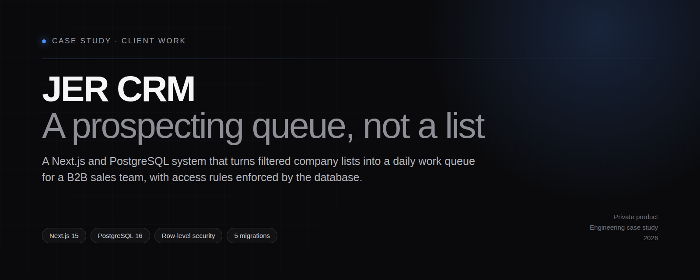
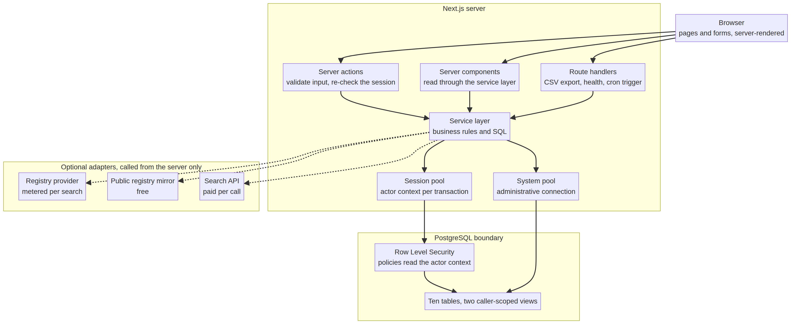
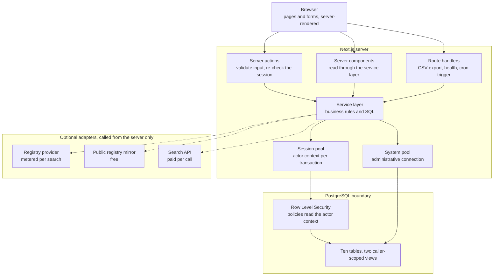
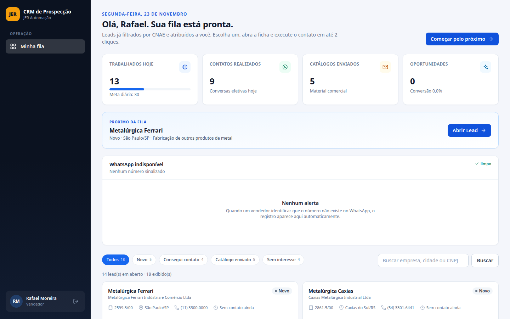
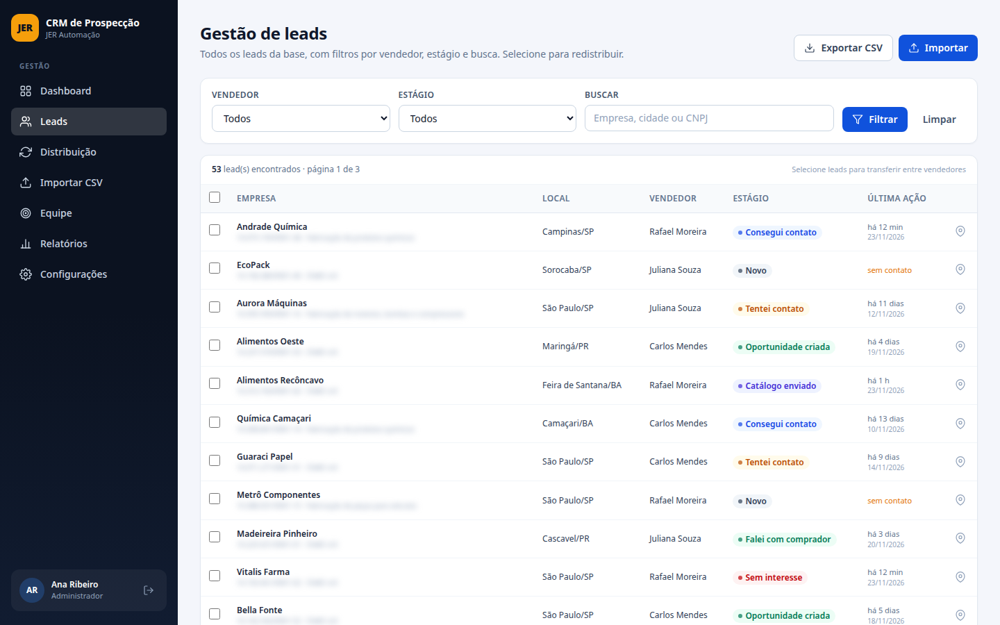
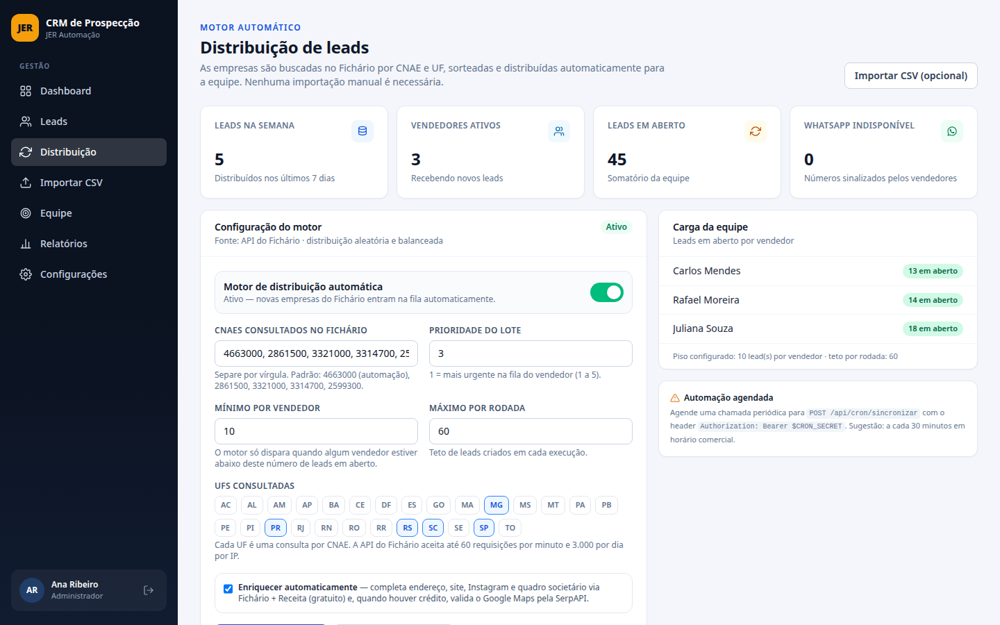
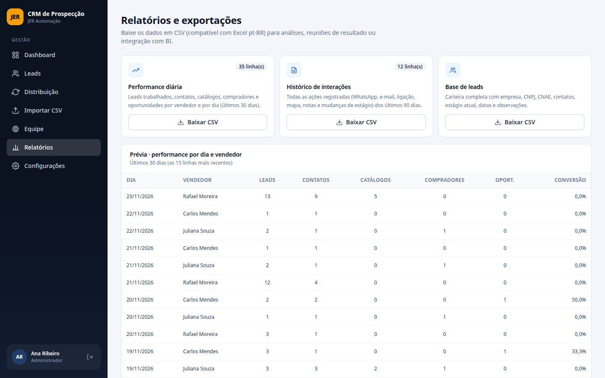

# JER CRM
[English](README.md) · [Português](README.pt-BR.md)

A prospecting CRM that turns filtered company lists into a daily work queue for a B2B sales team.



> **What this repository is.** A technical case study of a real, privately developed product built for JER Automação, an industrial automation distributor. It documents the architecture, the decisions that carried weight and the parts that were hard to get right. It is not the product source code, it is not open source, and no commercial detail is published.

## Overview

JER CRM is a prospecting system for a small industrial distributor. A salesperson opens a queue of companies filtered by economic activity code and state, reads the company record with registration data, contact details and officers, contacts the company by WhatsApp, e-mail or phone, and records the stage of that conversation. Managers watch the queue, the funnel and the daily activity of the team, and refill the queue from a commercial registry provider on a schedule.

The product serves one client and one workflow: outbound prospecting to factories, with no inbound capture, no marketing automation and no billing. It runs as a single Next.js application over PostgreSQL, with access rules enforced by the database itself. The implementation is private. What follows is the engineering account: what the system does, how it is put together, which decisions carried weight, and where the limits are.

## The problem

The commercial team sells automation components to factories. The addressable market is defined by economic activity code: machine builders, maintenance shops, system integrators, electrical installers. A paid registry provider returns those companies by code and state, but only as a list. Everything after the list was manual.

The team worked from spreadsheets. Someone exported the provider result, split rows by hand between salespeople and pasted phone numbers into WhatsApp Web. Four problems followed, and the business felt them every week:

1. **The queue ran dry.** Refilling it depended on one person remembering to export again. When the queue was empty, salespeople worked from memory or stopped.
2. **Load was uneven and invisible.** Nobody could say how many open companies each salesperson had, so the split was guesswork.
3. **The same company appeared more than once.** Head office and branches carry different tax IDs and the same commercial value, so one prospect could consume three positions in a queue.
4. **Nothing was recorded.** Stage, date, time and author of each contact lived in memory and in chat threads. Reports were reconstructions, not records.

So the engineering problem was not "build a CRM". It was to make the queue refill itself, the split fair, the record trustworthy, and the data honest about where it came from.

## What the product does

**Salesperson workspace.** A queue grouped by stage, with search over company, city and tax ID, and a shortcut to the oldest untouched company. Each record carries registration data, activity code and description, size, address, phone, e-mail, website and officers, plus one-click actions for WhatsApp with a prepared message, e-mail with a prepared subject and body, phone and maps. A seven-stage pipeline records each transition with date, time and user. Notes and the full interaction history sit on the same page as the daily counters of that salesperson.

**Management.** A performance panel with today against yesterday, a fourteen-day series, the funnel, a team ranking, monthly conversion and a feed of recent interactions. Lead management with filters by salesperson, stage and search, multi-select transfer between salespeople, and CSV exports for performance, interactions and the lead base.

**Automatic distribution.** A configured watch list of activity codes and states. On each round the engine searches the registry provider, discards companies already stored, shuffles the candidates and assigns them to the salespeople with the smallest open queue, under a per-round ceiling and a per-salesperson floor. A round starts from the admin panel or from an authenticated cron endpoint.

**Enrichment and verification.** On-demand completion of a company record from the company's own website, the registry provider and a public registry mirror, with an optional paid search step for maps and social profiles. Each record keeps the source that produced each field, and a failed source is labelled instead of guessed.

**Administration.** Users, daily targets, activation with protection of the last active administrator, message templates, company identity, and integration settings with a key test that does not spend a search credit.

## Architecture




| Component | Responsibility |
|---|---|
| Pages (server components) | Render the queue, the record and the panels; call services directly with the session |
| Server actions | Validate input with Zod, re-check session and role, call one service, revalidate the affected routes |
| Route handlers | CSV exports for administrators, health check, authenticated cron trigger |
| Service layer | Business rules and SQL; the only place that opens a transaction |
| Session pool | Application role, one transaction per unit of work, actor context written with `set_config` |
| System pool | Administrative connection used by registry ingestion, enrichment and scheduled rounds |
| PostgreSQL | Ten tables, twenty-three policies, two views declared as caller-scoped |
| Adapters | Registry provider, public registry mirror, search API; optional and configured at runtime |

A request that records a contact runs through five steps. The browser submits a server action with the assignment, the action type and an optional note. The action reads the session cookie and rejects the call without a session or with the wrong role. The service opens a transaction on the session pool and writes the actor into the transaction settings. Inside that transaction it reads the assignment, moves the stage, updates the last action timestamp and appends an interaction row with type, previous stage, new stage, user and time. The action revalidates the queue and the record, and the page renders again from the database rather than from client state.

## Engineering highlights

### Authorization that lives in the database

**Problem.** Two roles share one application. A salesperson may see only their own queue; an administrator sees everything. Enforcing that in every query makes each new query a chance to forget the filter.

**Decision.** PostgreSQL decides. The application connects with a role created without superuser rights and without `BYPASSRLS`, so policies apply to it. Every unit of work opens a transaction, writes the actor and the role into transaction-local settings with `set_config(name, value, true)`, and runs its queries there. Policies call stable helpers that read those settings; outside a transaction the helpers return null and nothing matches.

**Mechanism.** Reads, writes and the two caller-scoped reporting views pass through that boundary. Login is the one exception: a minimal `SECURITY DEFINER` function returns a single row for an e-mail before any context exists.

**Trade-off.** Authorization is duplicated at the server layer on purpose. The pool also serves system routines that need a wider role, policies cannot express action-level rules such as who may start a distribution round, and a database denial is a poor message for a salesperson. A forgotten context returns empty results, which fails safe but debugs badly.

### A distribution round that is fair, repeatable and cheap

**Problem.** The queue emptied faster than anyone could refill it by hand. A manual split took an hour and produced uneven loads and duplicate branches.

**Decision.** The engine watches a configured set of activity codes and states. Each round asks the registry provider for companies, drops what is already stored, shuffles the survivors and assigns them to active salespeople with the smallest open queue, under a per-round ceiling. A floor per salesperson decides whether a round runs at all.

**Mechanism.** The shuffle is Fisher-Yates over a cryptographic random source, so the order is not predictable. Writes happen in one transaction: a batch row, company upserts keyed by tax ID, and one assignment per company behind a unique constraint that makes a repeated round a no-op. The run is recorded with counts and duration.

**Trade-off.** Fairness is approximate, because the choice is random inside the least-loaded group rather than a global optimum. A round is bounded by the provider quota and by what the provider returns, so it is a refill, not a queue. The engine runs on the system pool, so authorization comes from the caller check, not from a policy.

### Third-party data with a quota and an honest fallback

**Problem.** A company record is assembled from four sources of different cost: the company's website (free), a commercial registry provider (metered), a public registry mirror (free) and a search API (paid per call). The metered provider enforces per-minute and per-day limits, and a batch that ignores them fails halfway.

**Decision.** Sources are ordered by cost. Free sources run on every enrichment; paid sources run only on an explicit request or in a bounded batch. Responses are cached under a hash of the normalised query with a time to live, a daily counter tracks consumption, and an in-memory window keeps the per-minute rate.

**Mechanism.** Batch work runs with a fixed number of workers. When a provider fails, the caller receives a result tagged as demonstration data with a warning string, and the interface prints it above the rows. Nothing is silently replaced, and the catalogue can be disabled.

**Trade-off.** The minute window lives in process memory, so the limit is per instance. The daily counter is a single row that every request updates. A fallback catalogue exists only because a demonstration without data is unusable, a compromise I would not repeat live.

### The audit trail is the reporting model

**Problem.** Sales metrics (companies worked, contacts, catalogues sent, opportunities) were being computed from the current state of each assignment. That state is mutable: moving an assignment forward erases the fact that it was ever behind. Reports could not answer who moved what, or when.

**Decision.** Every action appends an immutable interaction row with type, previous stage, new stage, actor and timestamp, in the same transaction that updates the assignment. Stage changes, notes, contact clicks and a separate "number not on WhatsApp" event all land in that table.

**Mechanism.** Reporting reads a view that groups interactions by salesperson and by day, converted to the business timezone inside SQL. The management panel, the personal counters and the CSV exports read that view or the same table, so a number on one screen matches the export.

**Trade-off.** Each interaction costs two writes, and aggregation runs on every panel load because there is no materialised rollup. Date columns are parsed as text in the driver, so a business date cannot shift by a day on a UTC server, which pushes formatting to the presentation layer.

## Tech stack

| Layer | Choice | Why |
|---|---|---|
| Application | Next.js 16 App Router, React 19, server components | Records are read and filtered on the server; the browser receives rendered pages, not a data API |
| Language | TypeScript 5 | One domain vocabulary across services, actions and pages |
| Styling | Tailwind CSS v4 | Styles stay next to the markup, with no runtime CSS layer |
| Validation | Zod 4 | One schema per action boundary, and errors that name the field |
| Data access | node-postgres, hand-written SQL | The policy is exercised on the same path as production; no ORM hides it |
| Database | PostgreSQL 16 with Row Level Security | Authorization enforced by the engine, not only by the application |
| Session | JWT HS256 in an httpOnly cookie, bcrypt hashes | Stateless session, no session store to operate |
| CSV | Papa Parse | Delimiter guessing and header normalisation for provider exports |
| External data | Registry provider, public mirror, search API | Commercial base for filtering, public registry for officers, search for maps and profiles |
| Tooling | tsx scripts, ESLint, `tsc --noEmit` | Schema changes run through one runner with a ledger table; the type check is a build gate |
| Scheduling | External scheduler calling an authenticated route | One daily refill does not justify a queue infrastructure |

## By the numbers

| Metric | Value |
|---|---|
| Tracked files | 110 |
| Lines in tracked files | about 15,400, excluding the lockfile |
| TypeScript files | 85 |
| SQL migrations | 5, about 560 lines |
| Tables | 10 |
| Row Level Security policies | 23 |
| Views | 2 |
| Pages | 11 |
| Route handlers | 5 |
| Server actions | 30 across 6 modules |
| React components | 22 |
| Service modules | 15 |
| Runtime dependencies | 8 |
| Development dependencies | 13 |
| Commits | 3 |
| Automated test suite | none |
| QA scripts | 5 Playwright scripts, run manually against a seeded database |
| Continuous integration | none |

## Screenshots

The application running locally against a seeded database. Registration numbers, phone numbers and street addresses are blurred in the captures, and the company and people names are generated for the demonstration. No client record appears in this repository.

The queue a salesperson works from, filtered by economic activity code and state:



The management view of the same base, where leads are redistributed between sellers:



Distribution of a batch across the team, and the funnel that managers read:





The remaining captures in `screenshots/` cover the login, the dashboard, the team page and the import screen.

## Security and privacy

Implemented: Row Level Security on all ten tables, with the application connecting as a role without superuser rights and without `BYPASSRLS`; the actor written into transaction-local settings on every unit of work; session and role re-checked on every action and export; a session cookie that is httpOnly, SameSite=Lax, Secure in production and valid for eight hours, signed with HS256; passwords hashed with bcrypt and never returned by a query; a single `SECURITY DEFINER` function for the login lookup, with `search_path` pinned and execute revoked from public; integration keys read only on the server through the administrative connection, never rendered to the browser; the settings row that holds keys readable by administrators only; CSV exports restricted to administrators and filtered by the same policies; protection of the last active administrator.

Not claimed: there is no MFA, no login rate limiting or lockout, no password rotation policy, no audit of reads (only writes are recorded), no encryption at rest beyond what the database provider offers, no compliance certification and no third-party penetration test. Third-party data may be incomplete or out of date, and the interface says so when a source fails. CSV exports do not neutralise spreadsheet formula prefixes. The administrative connection bypasses policies by design, so its callers are trusted code rather than a policy.

## Scope of this repository

Published: this document, the architecture, the decision records, the case study, the security model, two Mermaid sources, three examples rewritten from scratch with generic names, and the licence.

Omitted on purpose: the product source (85 TypeScript files), the full schema and policy definitions, the client's commercial configuration (activity codes, states, floors, ceilings, targets), integration endpoints and credentials, the demonstration credentials that ship with the seed, real company data, and the QA scripts. Where a detail would let someone rebuild the commercial product or identify a customer, the text describes the mechanism and stops.

## Repository map

```
.
├── README.md
├── LICENSE
├── .gitignore
├── docs/
│   ├── ARCHITECTURE.md
│   ├── CASE-STUDY.md
│   ├── DECISIONS.md
│   ├── SECURITY.md
│   └── banner.png
├── diagrams/
│   ├── architecture.mmd
│   └── flow.mmd
└── examples/
    ├── README.md
    ├── distribute_leads.ts
    ├── enrichment_cache.ts
    └── rls_session_context.sql
```

## Documentation

- [Architecture](docs/ARCHITECTURE.md)
- [Decisions](docs/DECISIONS.md)
- [Case study](docs/CASE-STUDY.md)
- [Security and privacy](docs/SECURITY.md)
- [Português](README.pt-BR.md)

## Author

**Hay Beaumont**, software engineer and architect. I design and build products end to end, including the data boundaries and the operational details that decide whether they survive contact with a sales team.

[github.com/yahbeaumont](https://github.com/yahbeaumont)
