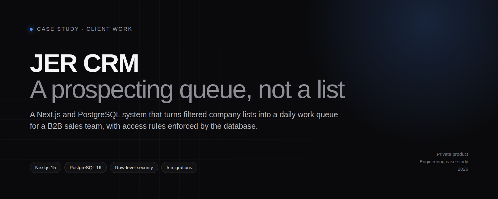
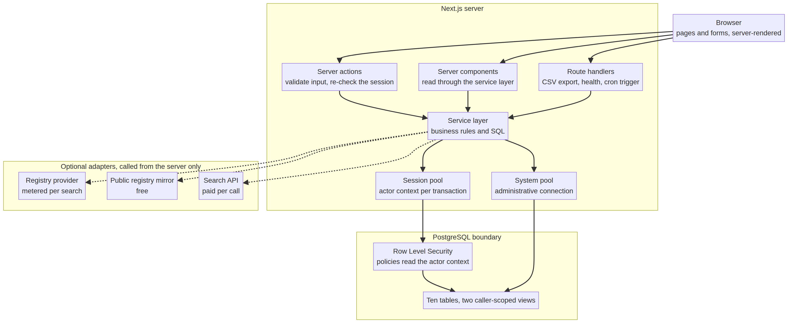
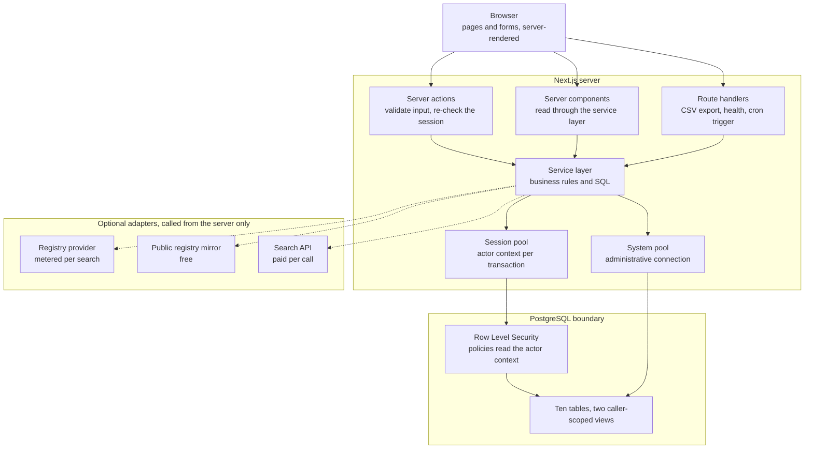
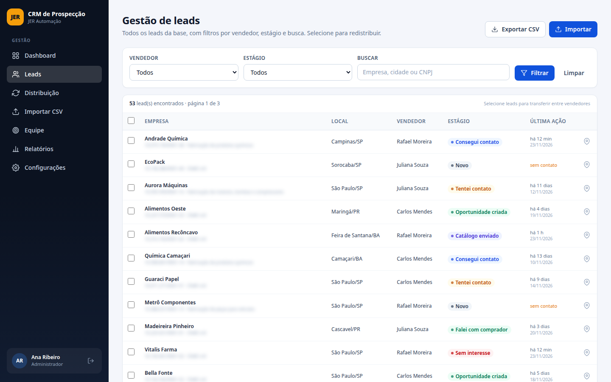
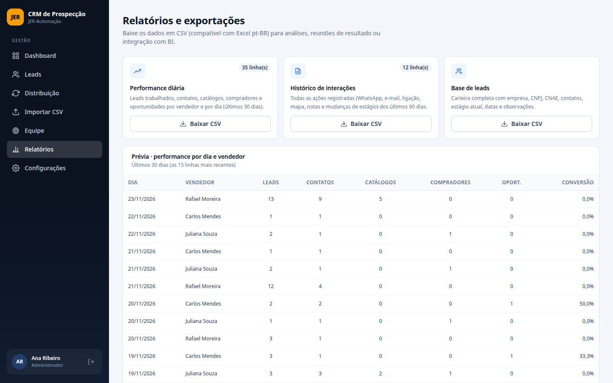

# JER CRM
[English](README.md) · **Português**

Um CRM de prospecção que transforma listas filtradas de empresas na fila de trabalho diária de um time comercial B2B.



> **O que este repositório é.** Um estudo de caso técnico de um produto real, desenvolvido em caráter privado para a JER Automação, uma distribuidora de automação industrial. Ele documenta a arquitetura, as decisões que pesaram e as partes que deram trabalho. Não é o código-fonte do produto, não é open source e não publica detalhe comercial nenhum.

## Visão geral

O JER CRM é o sistema de prospecção de uma pequena distribuidora industrial. O vendedor abre a fila de empresas filtrada por código de atividade econômica e por estado, lê o cadastro com os dados da empresa, os contatos e os sócios, fala com a empresa por WhatsApp, e-mail ou telefone e marca em que estágio a conversa parou. Do outro lado, os gestores acompanham a fila, o funil e a atividade diária do time e, em uma agenda, reabastecem a fila a partir de um provedor de base cadastral comercial.

O produto atende um cliente e um fluxo: prospecção ativa em fábricas, sem captura de inbound, sem automação de marketing e sem cobrança. É uma aplicação Next.js única sobre PostgreSQL, e as regras de acesso ficam no próprio banco de dados. A implementação é privada. O que segue é o relato de engenharia: o que o sistema faz, como está montado, quais decisões pesaram e onde estão os limites.

## O problema

O time comercial vende componentes de automação para fábricas. O mercado que ele ataca é definido por código de atividade econômica: fabricantes de máquinas, oficinas de manutenção, integradores de sistemas, instaladores elétricos. Um provedor de base cadastral pago devolve essas empresas por código e estado, mas só como lista. Depois da lista, tudo era manual.

O time trabalhava em planilhas. Alguém exportava o resultado do provedor, dividia as linhas à mão entre os vendedores e colava os telefones no WhatsApp Web. Daí vinham quatro problemas, e o negócio sentia cada um deles toda semana:

1. **A fila secava.** Reabastecer dependia de alguém lembrar de exportar de novo. Com a fila vazia, os vendedores trabalhavam de memória ou paravam.
2. **A carga era desigual e invisível.** Ninguém sabia dizer quantas empresas abertas cada vendedor tinha, então a divisão saía no chute.
3. **A mesma empresa aparecia mais de uma vez.** Matriz e filiais têm CNPJ diferente e o mesmo valor comercial, então um único prospect podia ocupar três posições da fila.
4. **Nada ficava registrado.** Estágio, data, hora e autor de cada contato viviam na memória e nas conversas de chat. Os relatórios eram reconstruções, não registros.

Então o problema de engenharia não era construir um CRM. Era fazer a fila se reabastecer sozinha, a divisão ser justa, o registro merecer confiança e o dado dizer com honestidade de onde veio.

## O que o produto faz

**Área do vendedor.** A fila aparece agrupada por estágio, com busca por empresa, cidade e CNPJ, mais um atalho para a empresa mais antiga que ninguém tocou ainda. Cada registro traz os dados cadastrais, o código e a descrição da atividade, o porte, o endereço, telefone, e-mail, site e sócios. Ao lado, ações de um clique: WhatsApp com mensagem pronta, e-mail com assunto e corpo prontos, telefone e mapas. Um pipeline de sete estágios registra cada transição com data, hora e usuário, e as notas e o histórico completo de interações ficam na mesma página dos contadores diários daquele vendedor.

**Gestão.** Um painel de desempenho com hoje contra ontem, uma série de quatorze dias, o funil, o ranking do time, a conversão mensal e um feed das interações recentes. A gestão de leads tem filtros por vendedor, estágio e busca, transferência de vários leads entre vendedores e exportação CSV de desempenho, interações e base de leads.

**Distribuição automática.** Uma lista de observação com os códigos de atividade e os estados que interessam. A cada rodada o motor consulta o provedor de base cadastral, descarta as empresas já armazenadas, embaralha os candidatos e distribui para os vendedores de menor fila aberta, dentro de um teto por rodada e de um piso por vendedor. A rodada começa no painel administrativo ou em um endpoint de cron autenticado.

**Enriquecimento e verificação.** O cadastro de uma empresa se completa sob demanda, com dados do site da própria empresa, do provedor de base cadastral e de um espelho público do registro. Há ainda uma etapa opcional de busca paga para mapas e perfis sociais. Cada campo guarda a fonte que o produziu, e fonte que falhou vem rotulada, não adivinhada.

**Administração.** Usuários, metas diárias, ativação com proteção do último administrador ativo, modelos de mensagem, identidade da empresa e configurações de integração, com um teste de chave que não gasta crédito de busca.

## Arquitetura




| Componente | Responsabilidade |
|---|---|
| Páginas (server components) | Renderizam a fila, o cadastro e os painéis; chamam os serviços direto, com a sessão |
| Server actions | Validam a entrada com Zod, reconferem sessão e papel, chamam um único serviço e revalidam as rotas afetadas |
| Route handlers | Exportação CSV para administradores, health check e o gatilho de cron autenticado |
| Camada de serviço | Regras de negócio e SQL; é o único lugar que abre transação |
| Session pool | Papel da aplicação, uma transação por unidade de trabalho e o contexto do ator gravado com `set_config` |
| System pool | Conexão administrativa usada pela ingestão cadastral, pelo enriquecimento e pelas rodadas agendadas |
| PostgreSQL | Dez tabelas, vinte e três políticas e duas views declaradas como caller-scoped |
| Adapters | Provedor de base cadastral, espelho público do registro e API de busca; opcionais e configurados em tempo de execução |

Uma requisição que registra um contato percorre cinco etapas. O navegador envia uma server action com a atribuição, o tipo de ação e uma nota opcional. A action lê o cookie de sessão e recusa a chamada quando não há sessão ou quando o papel não confere. O serviço abre uma transação no session pool e grava o ator nas configurações da transação. Dentro dela, lê a atribuição, move o estágio, atualiza o timestamp da última ação e acrescenta uma linha de interação com tipo, estágio anterior, novo estágio, usuário e hora. A action revalida a fila e o cadastro, e a página é renderizada de novo a partir do banco, não do estado do cliente.

## Destaques de engenharia

### Autorização que mora no banco de dados

**Problema.** Dois papéis dividem a mesma aplicação. O vendedor enxerga só a própria fila; o administrador enxerga tudo. Se cada consulta precisa aplicar esse filtro, toda consulta nova vira uma chance de esquecer. E o time é pequeno: a garantia tem de resistir a código descuidado, não apenas a código cuidadoso.

**Decisão.** Quem decide é o PostgreSQL. A aplicação se conecta com um papel criado sem direito de superusuário e sem `BYPASSRLS`, então as políticas valem para ela. Cada unidade de trabalho abre uma transação, grava o ator e o papel nas configurações locais da transação com `set_config(name, value, true)` e roda suas consultas ali dentro. As políticas chamam helpers estáveis que leem essas configurações. Fora de uma transação os helpers devolvem null e nenhuma linha casa.

**Mecanismo.** Leituras, escritas e as duas views de relatório caller-scoped passam por essa fronteira. O login é a única exceção: uma função `SECURITY DEFINER` mínima devolve uma linha por e-mail, antes de existir qualquer contexto.

**Trade-off.** A autorização se repete de propósito na camada de servidor. O pool também atende rotinas de sistema que precisam de um papel mais amplo; as políticas não dão conta de regra por ação, como quem pode iniciar uma rodada de distribuição; e uma negativa do banco é uma mensagem ruim para o vendedor. Contexto esquecido devolve resultado vazio, o que falha do lado seguro, mas dá trabalho para depurar.

### Uma rodada de distribuição justa, repetível e barata

**Problema.** A fila esvaziava mais rápido do que qualquer pessoa conseguia reabastecer à mão. Uma divisão manual levava uma hora e saía com carga desigual e filial duplicada.

**Decisão.** O motor vigia um conjunto configurado de códigos de atividade e estados. A cada rodada ele pede empresas ao provedor de base cadastral, descarta o que já está armazenado, embaralha o que sobrou e distribui aos vendedores ativos de menor fila aberta, sob um teto por rodada. Um piso por vendedor decide se a rodada acontece.

**Mecanismo.** O embaralhamento é Fisher-Yates sobre fonte aleatória criptográfica, então a ordem não se prevê. As escritas caem em uma transação só: uma linha de lote, upserts de empresa com chave no CNPJ e uma atribuição por empresa, atrás de uma constraint única que faz de uma rodada repetida um no-op. A execução fica registrada com contagens e duração.

**Trade-off.** A justiça é aproximada, porque a escolha é aleatória dentro do grupo menos carregado, não um ótimo global. E a rodada está limitada pela cota do provedor e pelo que o provedor devolve, então ela é um reabastecimento, não uma fila. O motor roda no system pool, então a autorização vem da checagem de quem chamou, não de uma política.

### Dados de terceiros com cota e um fallback honesto

**Problema.** O cadastro de uma empresa se monta a partir de quatro fontes de custo diferente: o site da empresa (grátis), um provedor de base cadastral comercial (medido), um espelho público do registro (grátis) e uma API de busca (paga por chamada). O provedor medido impõe limite por minuto e por dia, e um lote que ignora isso quebra no meio.

**Decisão.** As fontes entram em ordem de custo. As grátis rodam em todo enriquecimento; as pagas, só a pedido explícito ou em lote limitado. As respostas ficam em cache sob um hash da consulta normalizada, com tempo de vida, um contador diário acompanha o consumo e uma janela em memória segura a taxa por minuto.

**Mecanismo.** O trabalho em lote roda com um número fixo de workers. Quando um provedor falha, quem chamou recebe um resultado marcado como dado de demonstração, com uma string de aviso, e a interface imprime esse aviso acima das linhas. Nada é trocado em silêncio, e o catálogo pode ser desligado.

**Trade-off.** A janela de minuto vive na memória do processo, então o limite é por instância. O contador diário é uma linha única que toda requisição atualiza. E o catálogo de fallback existe só porque demonstração sem dado não serve para nada: é um compromisso que eu não repetiria em produção.

### A trilha de auditoria é o modelo de relatório

**Problema.** As métricas comerciais (empresas trabalhadas, contatos, catálogos enviados, oportunidades) saíam do estado atual de cada atribuição. Esse estado muda: avançar uma atribuição apaga o fato de que ela já esteve atrás. Os relatórios não respondiam quem moveu o quê, nem quando.

**Decisão.** Toda ação acrescenta uma linha de interação imutável, com tipo, estágio anterior, novo estágio, ator e timestamp, na mesma transação que atualiza a atribuição. Mudança de estágio, nota, clique de contato e um evento separado de "número não está no WhatsApp" caem todos nessa tabela.

**Mecanismo.** O relatório lê uma view que agrupa interações por vendedor e por dia, já convertidas para o fuso do negócio dentro do SQL. O painel de gestão, os contadores pessoais e as exportações CSV leem essa view ou a mesma tabela, então o número de uma tela bate com o da exportação.

**Trade-off.** Cada interação custa duas escritas, e a agregação roda a cada carregamento de painel, porque não existe rollup materializado. As colunas de data são lidas como texto no driver: uma data de negócio não muda de dia em servidor UTC, e a formatação fica na camada de apresentação.

## Stack de tecnologia

| Camada | Escolha | Por quê |
|---|---|---|
| Aplicação | Next.js 16 App Router, React 19, server components | Os registros são lidos e filtrados no servidor; o navegador recebe páginas renderizadas, não uma API de dados |
| Linguagem | TypeScript 5 | Um vocabulário de domínio só, entre serviços, actions e páginas |
| Estilo | Tailwind CSS v4 | O estilo fica ao lado do markup, sem camada de CSS em tempo de execução |
| Validação | Zod 4 | Um schema por fronteira de action, e erro que nomeia o campo |
| Acesso a dados | node-postgres, SQL escrito à mão | A política é exercitada no mesmo caminho da produção; nenhum ORM a esconde |
| Banco de dados | PostgreSQL 16 com Row Level Security | Autorização aplicada pelo motor, não apenas pela aplicação |
| Sessão | JWT HS256 em cookie httpOnly, hashes bcrypt | Sessão sem estado, nenhum session store para operar |
| CSV | Papa Parse | Detecção de delimitador e normalização de cabeçalho nas exportações do provedor |
| Dados externos | Provedor de base cadastral, espelho público, API de busca | Base comercial para filtrar, registro público para os sócios, busca para mapas e perfis |
| Ferramentas | scripts tsx, ESLint, `tsc --noEmit` | Mudança de schema passa por um runner único, com tabela de ledger; a checagem de tipos é portão de build |
| Agendamento | Scheduler externo chamando uma rota autenticada | Um reabastecimento por dia não justifica infraestrutura de queue |

## Em números

| Métrica | Valor |
|---|---|
| Arquivos rastreados | 110 |
| Linhas nos arquivos rastreados | cerca de 15.400, sem o lockfile |
| Arquivos TypeScript | 85 |
| Migrations SQL | 5, cerca de 560 linhas |
| Tabelas | 10 |
| Políticas de Row Level Security | 23 |
| Views | 2 |
| Páginas | 11 |
| Route handlers | 5 |
| Server actions | 30 em 6 módulos |
| Componentes React | 22 |
| Módulos de serviço | 15 |
| Dependências de runtime | 8 |
| Dependências de desenvolvimento | 13 |
| Commits | 3 |
| Suíte de testes automatizados | nenhuma |
| Scripts de QA | 5 scripts Playwright, rodados à mão contra um banco com seed |
| Integração contínua | nenhuma |

## Capturas de tela

A aplicação rodando local, em cima de um banco com seed. Nas capturas, CNPJ, telefones e endereços aparecem desfocados, e os nomes de empresas e de pessoas são gerados para a demonstração. Nenhum registro de cliente aparece neste repositório.

A fila de onde o vendedor trabalha, filtrada por código de atividade econômica e estado:


A visão de gestão da mesma base, onde os leads são redistribuídos entre os vendedores:



A distribuição de um lote pelo time, e o funil que os gestores leem:




As demais capturas em `screenshots/` cobrem o login, o dashboard, a página do time e a tela de importação.

## Segurança e privacidade

Implementado: Row Level Security nas dez tabelas, com a aplicação conectada por um papel sem direito de superusuário e sem `BYPASSRLS`; o ator gravado nas configurações locais da transação em cada unidade de trabalho; sessão e papel reconferidos em toda action e em toda exportação; cookie de sessão httpOnly, SameSite=Lax, Secure em produção, válido por oito horas e assinado com HS256; senha com hash bcrypt, que nenhuma consulta devolve; uma única função `SECURITY DEFINER` para a busca de login, com `search_path` fixo e execute revogado do público; chaves de integração lidas apenas no servidor, pela conexão administrativa, e nunca renderizadas para o navegador; a linha de configurações que guarda chaves, legível só por administradores; exportações CSV restritas a administradores e filtradas pelas mesmas políticas; proteção do último administrador ativo.

Não alegado: não há MFA, nem limite de tentativas ou bloqueio de login, nem política de rotação de senha, nem auditoria de leitura (só a escrita é registrada), nem criptografia em repouso além da que o provedor do banco oferece, nem certificação de conformidade, nem teste de penetração de terceiros. Dado de terceiro pode vir incompleto ou desatualizado, e a interface avisa quando uma fonte falha. As exportações CSV não neutralizam prefixo de fórmula de planilha. A conexão administrativa ignora as políticas por design: quem a chama é código confiável, não uma política.

## Escopo deste repositório

Publicado: este documento, a arquitetura, os registros de decisão, o estudo de caso, o modelo de segurança, duas fontes Mermaid, três exemplos reescritos do zero com nomes genéricos e a licença.

Omitido de propósito: o código do produto (85 arquivos TypeScript), o schema completo e as definições de política, a configuração comercial do cliente (códigos de atividade, estados, pisos, tetos, metas), endpoints e credenciais de integração, as credenciais de demonstração que vêm com o seed, dados reais de empresas e os scripts de QA. Onde um detalhe permitiria reconstruir o produto comercial ou identificar um cliente, o texto descreve o mecanismo e para por aí.

## Mapa do repositório

```
.
├── README.md
├── LICENSE
├── .gitignore
├── docs/
│   ├── ARCHITECTURE.md
│   ├── CASE-STUDY.md
│   ├── DECISIONS.md
│   ├── SECURITY.md
│   └── banner.png
├── diagrams/
│   ├── architecture.mmd
│   └── flow.mmd
└── examples/
    ├── README.md
    ├── distribute_leads.ts
    ├── enrichment_cache.ts
    └── rls_session_context.sql
```

## Documentação

- [Arquitetura](docs/pt-BR/ARQUITETURA.md)
- [Decisões](docs/pt-BR/DECISOES.md)
- [Estudo de caso](docs/pt-BR/ESTUDO-DE-CASO.md)
- [Segurança e privacidade](docs/pt-BR/SEGURANCA.md)
- [English](README.md)

## Autor

**Hay Beaumont**, engenheiro de software e arquiteto. Projeto e construo produtos de ponta a ponta, incluindo as fronteiras de dados e os detalhes de operação que decidem se o produto sobrevive ao contato com um time comercial.

[github.com/yahbeaumont](https://github.com/yahbeaumont)
