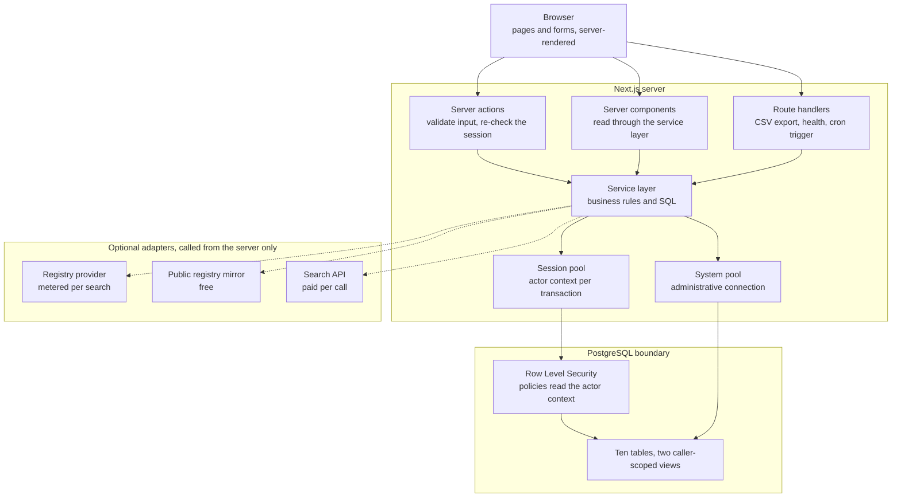
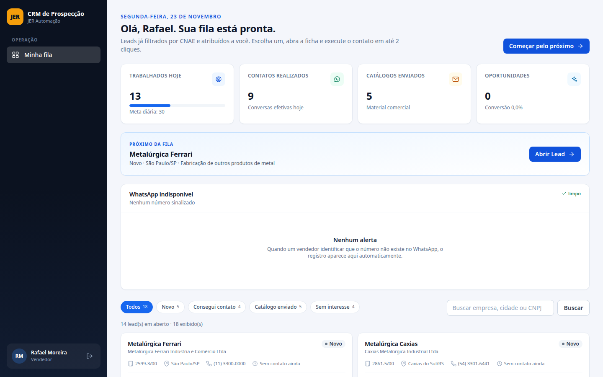
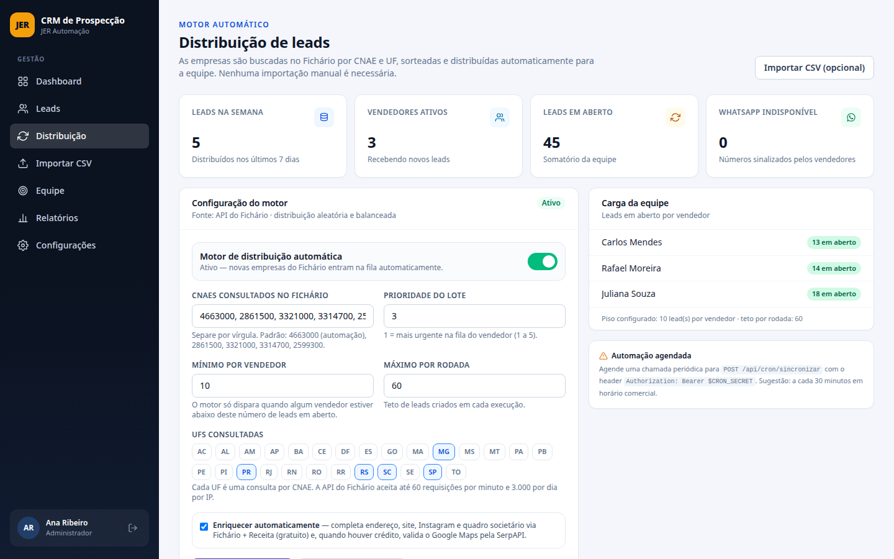

# JER CRM
[English](README.md) · **Português**

Um CRM de prospecção que transforma listas de empresas filtradas em uma fila de trabalho diária para um time comercial B2B.


> **O que este repositório é.** Um estudo de caso técnico de um produto real, desenvolvido de forma privada para a JER Automação, uma distribuidora de automação industrial. Ele documenta a arquitetura, as decisões que tiveram peso e as partes que foram difíceis de acertar. Não é o código-fonte do produto, não é open source e nenhum detalhe comercial é publicado.

## Visão geral

O JER CRM é um sistema de prospecção para uma pequena distribuidora industrial. O vendedor abre uma fila de empresas filtradas por código de atividade econômica e estado, lê o cadastro da empresa com dados cadastrais, contatos e sócios, fala com a empresa por WhatsApp, e-mail ou telefone e registra o estágio daquela conversa. Os gestores acompanham a fila, o funil e a atividade diária do time, e reabastecem a fila a partir de um provedor de base cadastral comercial em uma agenda.

O produto atende um cliente e um fluxo de trabalho: prospecção ativa em fábricas, sem captura inbound, sem automação de marketing e sem cobrança. Roda como uma única aplicação Next.js sobre PostgreSQL, com as regras de acesso aplicadas pelo próprio banco de dados. A implementação é privada. O que segue é o relato de engenharia: o que o sistema faz, como está montado, quais decisões tiveram peso e onde estão os limites.

## O problema

O time comercial vende componentes de automação para fábricas. O mercado endereçável é definido por código de atividade econômica: fabricantes de máquinas, oficinas de manutenção, integradores de sistemas, instaladores elétricos. Um provedor de base cadastral pago devolve essas empresas por código e estado, mas apenas como uma lista. Tudo depois da lista era manual.

O time trabalhava em planilhas. Alguém exportava o resultado do provedor, dividia as linhas à mão entre os vendedores e colava os telefones no WhatsApp Web. Quatro problemas vinham junto, e o negócio sentia cada um deles toda semana:

1. **A fila secava.** Reabastecê-la dependia de uma pessoa lembrar de exportar de novo. Quando a fila estava vazia, os vendedores trabalhavam de memória ou paravam.
2. **A carga era desigual e invisível.** Ninguém sabia dizer quantas empresas abertas cada vendedor tinha, então a divisão era um chute.
3. **A mesma empresa aparecia mais de uma vez.** Matriz e filiais têm CNPJ diferentes e o mesmo valor comercial, então um único prospect podia consumir três posições na fila.
4. **Nada era registrado.** Estágio, data, hora e autor de cada contato viviam na memória e nas conversas de chat. Os relatórios eram reconstruções, não registros.

Então o problema de engenharia não era "construir um CRM". Era fazer a fila se reabastecer sozinha, a divisão ser justa, o registro ser confiável e os dados serem honestos sobre de onde vieram.

## O que o produto faz

**Área do vendedor.** Uma fila agrupada por estágio, com busca por empresa, cidade e CNPJ, e um atalho para a empresa mais antiga ainda não trabalhada. Cada registro traz dados cadastrais, código e descrição da atividade, porte, endereço, telefone, e-mail, site e sócios, além de ações em um clique para WhatsApp com mensagem pronta, e-mail com assunto e corpo prontos, telefone e mapas. Um pipeline de sete estágios registra cada transição com data, hora e usuário. As notas e o histórico completo de interações ficam na mesma página que os contadores diários daquele vendedor.

**Gestão.** Um painel de desempenho com hoje contra ontem, uma série de quatorze dias, o funil, um ranking do time, conversão mensal e um feed de interações recentes. Um módulo de leads com filtros por vendedor, estágio e busca, transferência em múltipla seleção entre vendedores e exportações CSV de desempenho, interações e base de leads.

**Distribuição automática.** Uma lista de observação configurada de códigos de atividade e estados. A cada rodada o motor consulta o provedor de base cadastral, descarta as empresas já armazenadas, embaralha os candidatos e os atribui aos vendedores com a menor fila aberta, sob um teto por rodada e um piso por vendedor. Uma rodada começa no painel administrativo ou em um endpoint de cron autenticado.

**Enriquecimento e verificação.** Complemento sob demanda do cadastro de uma empresa a partir do site da própria empresa, do provedor de base cadastral e de um espelho público do registro, com uma etapa opcional de busca paga para mapas e perfis sociais. Cada registro guarda a fonte que produziu cada campo, e uma fonte que falhou é rotulada em vez de adivinhada.

**Administração.** Usuários, metas diárias, ativação com proteção do último administrador ativo, modelos de mensagem, identidade da empresa e configurações de integração com um teste de chave que não consome crédito de busca.

## Arquitetura




| Componente | Responsabilidade |
|---|---|
| Páginas (server components) | Renderizam a fila, o cadastro e os painéis; chamam os serviços diretamente com a sessão |
| Server actions | Validam a entrada com Zod, reconferem sessão e papel, chamam um serviço, revalidam as rotas afetadas |
| Route handlers | Exportações CSV para administradores, health check, gatilho de cron autenticado |
| Camada de serviço | Regras de negócio e SQL; o único lugar que abre uma transação |
| Session pool | Papel da aplicação, uma transação por unidade de trabalho, contexto do ator gravado com `set_config` |
| System pool | Conexão administrativa usada pela ingestão cadastral, pelo enriquecimento e pelas rodadas agendadas |
| PostgreSQL | Dez tabelas, vinte e três políticas, duas views declaradas como caller-scoped |
| Adapters | Provedor de base cadastral, espelho público do registro, API de busca; opcionais e configurados em tempo de execução |

Uma requisição que registra um contato passa por cinco etapas. O navegador envia uma server action com a atribuição, o tipo de ação e uma nota opcional. A action lê o cookie de sessão e rejeita a chamada sem sessão ou com o papel errado. O serviço abre uma transação no session pool e grava o ator nas configurações da transação. Dentro dessa transação ele lê a atribuição, move o estágio, atualiza o timestamp da última ação e acrescenta uma linha de interação com tipo, estágio anterior, novo estágio, usuário e hora. A action revalida a fila e o cadastro, e a página é renderizada de novo a partir do banco de dados, não do estado do cliente.

## Destaques de engenharia

### Autorização que mora no banco de dados

**Problema.** Dois papéis compartilham uma aplicação. Um vendedor pode ver apenas a própria fila; um administrador vê tudo. Aplicar isso em cada consulta faz de cada nova consulta uma chance de esquecer o filtro.

**Decisão.** O PostgreSQL decide. A aplicação se conecta com um papel criado sem direitos de superusuário e sem `BYPASSRLS`, então as políticas se aplicam a ele. Cada unidade de trabalho abre uma transação, grava o ator e o papel nas configurações locais da transação com `set_config(name, value, true)` e executa suas consultas ali. As políticas chamam helpers estáveis que leem essas configurações; fora de uma transação os helpers retornam null e nada casa.

**Mecanismo.** Leituras, escritas e as duas views de relatório caller-scoped passam por essa fronteira. O login é a única exceção: uma função `SECURITY DEFINER` mínima retorna uma única linha para um e-mail antes de existir qualquer contexto.

**Trade-off.** A autorização é duplicada na camada de servidor de propósito. O pool também atende rotinas de sistema que precisam de um papel mais amplo, as políticas não conseguem expressar regras no nível da ação, como quem pode iniciar uma rodada de distribuição, e uma negação do banco é uma mensagem ruim para um vendedor. Um contexto esquecido retorna resultados vazios, o que falha de forma segura, mas depura mal.

### Uma rodada de distribuição justa, repetível e barata

**Problema.** A fila esvaziava mais rápido do que qualquer pessoa conseguia reabastecê-la à mão. Uma divisão manual levava uma hora e produzia cargas desiguais e filiais duplicadas.

**Decisão.** O motor observa um conjunto configurado de códigos de atividade e estados. Cada rodada pede empresas ao provedor de base cadastral, descarta o que já está armazenado, embaralha os sobreviventes e os atribui aos vendedores ativos com a menor fila aberta, sob um teto por rodada. Um piso por vendedor decide se a rodada acontece ou não.

**Mecanismo.** O embaralhamento é Fisher-Yates sobre uma fonte aleatória criptográfica, então a ordem não é previsível. As escritas acontecem em uma transação: uma linha de lote, upserts de empresa com chave no CNPJ e uma atribuição por empresa atrás de uma constraint única que transforma uma rodada repetida em no-op. A execução é registrada com contagens e duração.

**Trade-off.** A justiça é aproximada, porque a escolha é aleatória dentro do grupo menos carregado, e não um ótimo global. Uma rodada é limitada pela cota do provedor e pelo que o provedor retorna, então ela é um reabastecimento, não uma fila. O motor roda no system pool, então a autorização vem da checagem do chamador, não de uma política.

### Dados de terceiros com cota e um fallback honesto

**Problema.** O cadastro de uma empresa é montado a partir de quatro fontes de custo diferente: o site da empresa (grátis), um provedor de base cadastral comercial (medido), um espelho público do registro (grátis) e uma API de busca (paga por chamada). O provedor medido impõe limites por minuto e por dia, e um lote que os ignora falha no meio do caminho.

**Decisão.** As fontes são ordenadas por custo. As fontes grátis rodam em todo enriquecimento; as fontes pagas rodam apenas sob pedido explícito ou em um lote limitado. As respostas são cacheadas sob um hash da consulta normalizada com um tempo de vida, um contador diário acompanha o consumo e uma janela em memória mantém a taxa por minuto.

**Mecanismo.** O trabalho em lote roda com um número fixo de workers. Quando um provedor falha, o chamador recebe um resultado marcado como dado de demonstração com uma string de aviso, e a interface a imprime acima das linhas. Nada é substituído em silêncio, e o catálogo pode ser desativado.

**Trade-off.** A janela de minuto vive na memória do processo, então o limite é por instância. O contador diário é uma única linha que toda requisição atualiza. Um catálogo de fallback existe apenas porque uma demonstração sem dados é inutilizável, um compromisso que eu não repetiria em produção.

### A trilha de auditoria é o modelo de relatório

**Problema.** As métricas comerciais (empresas trabalhadas, contatos, catálogos enviados, oportunidades) eram calculadas a partir do estado atual de cada atribuição. Esse estado é mutável: avançar uma atribuição apaga o fato de que ela já esteve atrás. Os relatórios não conseguiam responder quem moveu o quê, nem quando.

**Decisão.** Cada ação acrescenta uma linha de interação imutável com tipo, estágio anterior, novo estágio, ator e timestamp, na mesma transação que atualiza a atribuição. Mudanças de estágio, notas, cliques de contato e um evento separado de "número não está no WhatsApp" caem todos nessa tabela.

**Mecanismo.** O relatório lê uma view que agrupa interações por vendedor e por dia, convertidas para o fuso horário do negócio dentro do SQL. O painel de gestão, os contadores pessoais e as exportações CSV leem essa view ou a mesma tabela, então um número em uma tela bate com a exportação.

**Trade-off.** Cada interação custa duas escritas, e a agregação roda a cada carregamento de painel porque não existe rollup materializado. As colunas de data são lidas como texto no driver, então uma data de negócio não pode mudar de dia em um servidor em UTC, o que empurra a formatação para a camada de apresentação.

## Stack de tecnologia

| Camada | Escolha | Por quê |
|---|---|---|
| Aplicação | Next.js 16 App Router, React 19, server components | Os registros são lidos e filtrados no servidor; o navegador recebe páginas renderizadas, não uma API de dados |
| Linguagem | TypeScript 5 | Um único vocabulário de domínio entre serviços, actions e páginas |
| Estilo | Tailwind CSS v4 | Os estilos ficam ao lado do markup, sem camada de CSS em tempo de execução |
| Validação | Zod 4 | Um schema por fronteira de ação, e erros que nomeiam o campo |
| Acesso a dados | node-postgres, SQL escrito à mão | A política é exercitada no mesmo caminho da produção; nenhum ORM a esconde |
| Banco de dados | PostgreSQL 16 com Row Level Security | Autorização aplicada pelo motor, não apenas pela aplicação |
| Sessão | JWT HS256 em cookie httpOnly, hashes bcrypt | Sessão sem estado, nenhum session store para operar |
| CSV | Papa Parse | Detecção de delimitador e normalização de cabeçalho para as exportações do provedor |
| Dados externos | Provedor de base cadastral, espelho público, API de busca | Base comercial para filtragem, registro público para os sócios, busca para mapas e perfis |
| Ferramentas | scripts tsx, ESLint, `tsc --noEmit` | Mudanças de schema passam por um único runner com uma tabela de ledger; a checagem de tipos é um portão de build |
| Agendamento | Scheduler externo chamando uma rota autenticada | Um reabastecimento diário não justifica uma infraestrutura de queue |

## Em números

| Métrica | Valor |
|---|---|
| Arquivos rastreados | 110 |
| Linhas nos arquivos rastreados | cerca de 15.400, sem o lockfile |
| Arquivos TypeScript | 85 |
| Migrations SQL | 5, cerca de 560 linhas |
| Tabelas | 10 |
| Políticas de Row Level Security | 23 |
| Views | 2 |
| Páginas | 11 |
| Route handlers | 5 |
| Server actions | 30 em 6 módulos |
| Componentes React | 22 |
| Módulos de serviço | 15 |
| Dependências de runtime | 8 |
| Dependências de desenvolvimento | 13 |
| Commits | 3 |
| Suíte de testes automatizados | nenhuma |
| Scripts de QA | 5 scripts Playwright, executados manualmente contra um banco com seed |
| Integração contínua | nenhuma |

## Capturas de tela

A aplicação rodando localmente contra um banco com seed. Números de registro, telefones e endereços estão desfocados nas capturas, e os nomes de empresas e pessoas são gerados para a demonstração. Nenhum registro de cliente aparece neste repositório.

A fila a partir da qual o vendedor trabalha, filtrada por código de atividade econômica e estado:



A visão de gestão da mesma base, onde os leads são redistribuídos entre os vendedores:


A distribuição de um lote pelo time, e o funil que os gestores leem:




As demais capturas em `screenshots/` cobrem o login, o dashboard, a página de time e a tela de importação.

## Segurança e privacidade

Implementado: Row Level Security em todas as dez tabelas, com a aplicação se conectando como um papel sem direitos de superusuário e sem `BYPASSRLS`; o ator gravado nas configurações locais da transação em cada unidade de trabalho; sessão e papel reconferidos em cada action e em cada exportação; um cookie de sessão httpOnly, SameSite=Lax, Secure em produção e válido por oito horas, assinado com HS256; senhas com hash bcrypt e nunca devolvidas por uma consulta; uma única função `SECURITY DEFINER` para a busca de login, com `search_path` fixo e execute revogado do público; chaves de integração lidas apenas no servidor pela conexão administrativa, nunca renderizadas para o navegador; a linha de configurações que guarda chaves legível apenas por administradores; exportações CSV restritas a administradores e filtradas pelas mesmas políticas; proteção do último administrador ativo.

Não alegado: não há MFA, nem limite de tentativas de login ou bloqueio, nem política de rotação de senha, nem auditoria de leituras (apenas escritas são registradas), nem criptografia em repouso além do que o provedor do banco oferece, nem certificação de conformidade e nem teste de penetração de terceiros. Dados de terceiros podem estar incompletos ou desatualizados, e a interface avisa quando uma fonte falha. As exportações CSV não neutralizam prefixos de fórmula de planilha. A conexão administrativa ignora as políticas por design, então seus chamadores são código confiável, não uma política.

## Escopo deste repositório

Publicado: este documento, a arquitetura, os registros de decisão, o estudo de caso, o modelo de segurança, duas fontes Mermaid, três exemplos reescritos do zero com nomes genéricos e a licença.

Omitido de propósito: o código-fonte do produto (85 arquivos TypeScript), o schema completo e as definições de política, a configuração comercial do cliente (códigos de atividade, estados, pisos, tetos, metas), endpoints e credenciais de integração, as credenciais de demonstração que acompanham o seed, dados reais de empresas e os scripts de QA. Onde um detalhe permitiria a alguém reconstruir o produto comercial ou identificar um cliente, o texto descreve o mecanismo e para.

## Mapa do repositório

```
.
├── README.md
├── LICENSE
├── .gitignore
├── docs/
│   ├── ARCHITECTURE.md
│   ├── CASE-STUDY.md
│   ├── DECISIONS.md
│   ├── SECURITY.md
│   └── banner.png
├── diagrams/
│   ├── architecture.mmd
│   └── flow.mmd
└── examples/
    ├── README.md
    ├── distribute_leads.ts
    ├── enrichment_cache.ts
    └── rls_session_context.sql
```

## Documentação

- [Arquitetura](docs/pt-BR/ARQUITETURA.md)
- [Decisões](docs/pt-BR/DECISOES.md)
- [Estudo de caso](docs/pt-BR/ESTUDO-DE-CASO.md)
- [Segurança e privacidade](docs/pt-BR/SEGURANCA.md)
- [English](README.md)

## Autor

**Hay Beaumont**, engenheiro de software e arquiteto. Eu projeto e construo produtos de ponta a ponta, incluindo as fronteiras de dados e os detalhes operacionais que decidem se eles sobrevivem ao contato com um time comercial.

[github.com/yahbeaumont](https://github.com/yahbeaumont)
