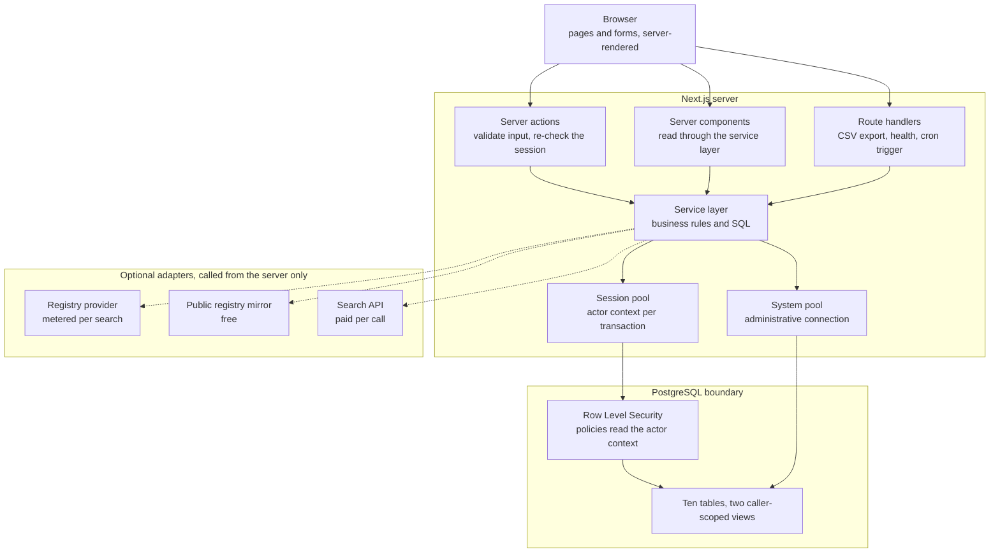

# Architecture

## 1. Context

JER CRM is an internal prospecting system for one company. Three surfaces share one database: the salesperson queue, the management panels, and the scheduled ingestion that refills the queue from a commercial registry provider. There is no public API and no customer-facing surface.

It runs as one Next.js application on a Node runtime with PostgreSQL. The server holds every credential, makes every external call and is the only client of the database; the browser receives rendered pages and submits forms.

Two constraints shaped the design. One salesperson's queue must not be readable by another, even if a request is forged. And the registry provider is metered, so every search has a cost and a rate limit.

## 2. Components and responsibilities

**Pages.** Server components. A page resolves the session, calls services with it and renders the result. Pages hold no SQL and make no access decisions.

**Server actions.** The only mutation entry point from the browser. Each action validates its payload, re-reads the session, checks the role, calls one service, revalidates the affected routes and returns a discriminated result. A failure becomes `{ ok: false, error, code }`, never a stack trace.

**Route handlers.** Three CSV exports restricted to managers, a health check, and the cron trigger, authenticated with a shared secret in a header or query parameter.

**Service layer.** Fifteen modules with business rules and SQL. A service receives the session explicitly, never reads cookies, and opens its own transaction. It also chooses the connection: session pool for user requests, system pool for ingestion, enrichment and run bookkeeping.

**Adapters.** Three external systems behind modules with a shared shape: a timeout, tolerant parsing, and a mapping from transport failures to the internal error taxonomy.

**Database.** PostgreSQL with Row Level Security on every table. Two views expose daily performance and funnel totals, declared caller-scoped, so a query through them is filtered exactly like a query on the base tables.

## 3. Boundaries and contracts

*Browser to action.* A typed payload validated before use and one result union: success with a message, or failure with a message and a code from a closed set.

*Page to service.* A session object plus plain arguments. No service has a variant that skips the session. The login lookup is the single exception and goes through a database function that returns one row.

*Service to database.* One transaction per unit of work. On the session pool the transaction begins by writing the actor and the role into transaction-local settings, which the policies read. The system pool writes reference data and run records and is not subject to policies, because it connects as the schema owner.

*Service to adapter.* A bounded call with a timeout, no retry inside the request path, and a result that carries data or a reason. Enrichment records a failed source and continues.

## 4. Request flow

Recording a contact:

1. The salesperson clicks a quick action. The browser submits an action with the assignment, the type and an optional note.
2. The action validates the payload, reads the signed cookie and rejects a missing session.
3. The service opens a transaction on the session pool and sets the actor context.
4. It reads the assignment. The policy returns the row only for its owner or a manager, so a forged identifier produces an empty result and a "not found or no permission" error.
5. It updates the stage and the last action timestamp, then appends an interaction with type, previous stage, new stage, actor and time. Both writes commit together.
6. The action revalidates the queue, the record, the panel and the reports; the page renders again from the server.

An export follows the same shape with a different transport: the route handler reads the session, refuses anyone but a manager, calls the reporting service and streams a semicolon-separated file. The policy applies to the query behind the file as it applies to the panel.

## 5. Conceptual data model

**Account.** Name, e-mail, password hash, role, daily target, active flag.

**Company.** Registry record keyed by tax ID: names, activity code, size, status, opening date, capital, address, contact details, social profiles, enrichment metadata and WhatsApp state.

**Batch.** One ingestion: label, filters, source, count, author, time.

**Assignment.** A company given to a salesperson: stage, priority, timestamps, notes; unique per company and salesperson.

**Interaction.** Append-only row per action: actor, type, text, previous and new stage, time. The record of what happened and the source of every metric.

**Officer.** Partner from the public registry: qualification, age band, masked document, entry date.

**Run.** One distribution round: origin, filters, counters, error, duration.

**Setting.** Key with a JSON value and an author; keys holding credentials are manager-only.

**Cache entry and counter.** Cached provider responses with an expiry, and a per-day request count.

Relations: a company has many assignments and officers; an assignment has many interactions; a batch groups one ingestion's assignments; an account owns assignments and interactions.

## 6. Deployment decisions

One Node process, on a container, platform runtime or virtual machine. PostgreSQL 14 or newer is the only stateful dependency; a managed instance works because nothing needs superuser features beyond creating the application role once.

Schema changes are SQL files applied in order by a runner that records each filename in a ledger table and wraps each file in a transaction. The runner connects as the schema owner; the application connects with a restricted role. Configuration comes from environment variables, with two provider keys editable in the interface so rotation does not need a deployment.

The scheduler is external: anything able to send a request with a bearer secret. Health is a route handler that reports database connectivity and returns 503 when the database is unreachable.

## 7. Known limits

- The per-minute provider limit lives in process memory, so it is per instance.
- The daily counter is one row updated by every request, which serialises writes under load.
- Enrichment runs inside the request or the scheduled round, with no job queue and no retry with backoff.
- Reporting aggregates on read and would need materialisation at a much larger volume.
- The system pool connects as the schema owner and bypasses policies; its safety depends on which functions may call it.
- Uniqueness is per company and salesperson, so a manual import can give a company to a second salesperson.
- Dates are read as text in the driver, which keeps business dates stable and moves formatting to the presentation layer.
- Exports are CSV only, and outbound e-mail uses the user's client through a `mailto:` link rather than an API.
