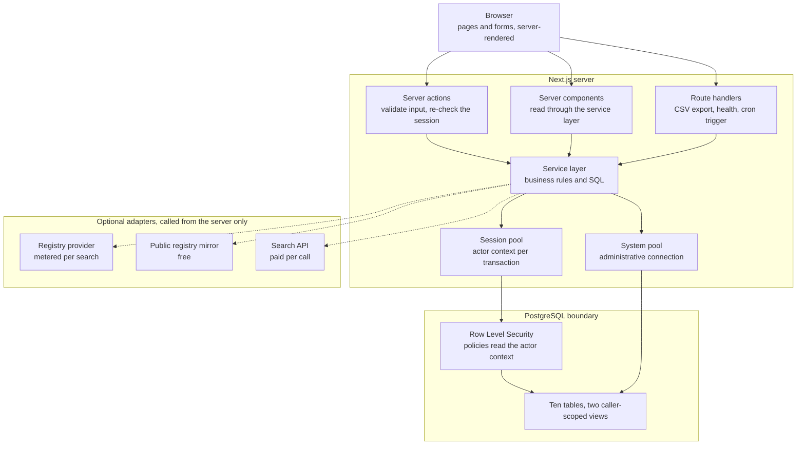

# Arquitetura

## 1. Contexto

O JER CRM é um sistema de prospecção interno para uma empresa. Três superfícies compartilham um único banco de dados: a fila do vendedor, os painéis de gestão e a ingestão agendada que reabastece a fila a partir de um provedor de base cadastral comercial. Não existe API pública nem superfície voltada a clientes.

Roda como uma única aplicação Next.js em um runtime Node com PostgreSQL. O servidor guarda toda credencial, faz toda chamada externa e é o único cliente do banco de dados; o navegador recebe páginas renderizadas e envia formulários.

Duas restrições moldaram o design. A fila de um vendedor não pode ser legível por outro, mesmo que uma requisição seja forjada. E o provedor de base cadastral é medido, então toda busca tem custo e limite de taxa.

## 2. Componentes e responsabilidades

**Páginas.** Server components. Uma página resolve a sessão, chama os serviços com ela e renderiza o resultado. As páginas não contêm SQL e não tomam decisões de acesso.

**Server actions.** O único ponto de entrada de mutação a partir do navegador. Cada action valida seu payload, relê a sessão, confere o papel, chama um serviço, revalida as rotas afetadas e retorna um resultado discriminado. Uma falha vira `{ ok: false, error, code }`, nunca um stack trace.

**Route handlers.** Três exportações CSV restritas a gestores, um health check e o gatilho de cron, autenticado com um segredo compartilhado em um header ou parâmetro de consulta.

**Camada de serviço.** Quinze módulos com regras de negócio e SQL. Um serviço recebe a sessão explicitamente, nunca lê cookies e abre a própria transação. Ele também escolhe a conexão: session pool para requisições de usuário, system pool para ingestão, enriquecimento e contabilidade das rodadas.

**Adapters.** Três sistemas externos atrás de módulos com um formato comum: timeout, parsing tolerante e um mapeamento de falhas de transporte para a taxonomia interna de erros.

**Banco de dados.** PostgreSQL com Row Level Security em todas as tabelas. Duas views expõem desempenho diário e totais de funil, declaradas caller-scoped, então uma consulta por elas é filtrada exatamente como uma consulta nas tabelas base.

## 3. Fronteiras e contratos

*Navegador para action.* Um payload tipado e validado antes do uso e uma união de resultado: sucesso com uma mensagem, ou falha com uma mensagem e um código de um conjunto fechado.

*Página para serviço.* Um objeto de sessão mais argumentos simples. Nenhum serviço tem uma variante que dispensa a sessão. A busca de login é a única exceção e passa por uma função de banco que retorna uma linha.

*Serviço para banco de dados.* Uma transação por unidade de trabalho. No session pool a transação começa gravando o ator e o papel nas configurações locais da transação, que as políticas leem. O system pool grava dados de referência e registros de execução e não está sujeito às políticas, porque se conecta como o dono do schema.

*Serviço para adapter.* Uma chamada limitada com timeout, sem retry no caminho da requisição, e um resultado que carrega dados ou um motivo. O enriquecimento registra uma fonte que falhou e continua.

## 4. Fluxo de uma requisição

Registrando um contato:

1. O vendedor clica em uma ação rápida. O navegador envia uma action com a atribuição, o tipo e uma nota opcional.
2. A action valida o payload, lê o cookie assinado e rejeita uma sessão ausente.
3. O serviço abre uma transação no session pool e define o contexto do ator.
4. Ele lê a atribuição. A política só retorna a linha para o dono dela ou para um gestor, então um identificador forjado produz um resultado vazio e um erro de "não encontrado ou sem permissão".
5. Ele atualiza o estágio e o timestamp da última ação e então acrescenta uma interação com tipo, estágio anterior, novo estágio, ator e hora. As duas escritas são confirmadas juntas.
6. A action revalida a fila, o cadastro, o painel e os relatórios; a página é renderizada de novo a partir do servidor.

Uma exportação segue o mesmo formato com um transporte diferente: o route handler lê a sessão, recusa qualquer pessoa que não seja gestor, chama o serviço de relatórios e transmite um arquivo separado por ponto e vírgula. A política se aplica à consulta por trás do arquivo como se aplica ao painel.

## 5. Modelo de dados conceitual

**Conta.** Nome, e-mail, hash de senha, papel, meta diária, flag de ativo.

**Empresa.** Registro cadastral com chave no CNPJ: nomes, código de atividade, porte, situação, data de abertura, capital, endereço, dados de contato, perfis sociais, metadados de enriquecimento e estado de WhatsApp.

**Lote.** Uma ingestão: rótulo, filtros, fonte, contagem, autor, hora.

**Atribuição.** Uma empresa entregue a um vendedor: estágio, prioridade, timestamps, notas; única por empresa e vendedor.

**Interação.** Linha somente de acréscimo por ação: ator, tipo, texto, estágio anterior e novo estágio, hora. O registro do que aconteceu e a fonte de toda métrica.

**Sócio.** Vindo do registro público: qualificação, faixa etária, documento mascarado, data de entrada.

**Execução.** Uma rodada de distribuição: origem, filtros, contadores, erro, duração.

**Configuração.** Chave com um valor JSON e um autor; as chaves que guardam credenciais são apenas para gestores.

**Entrada de cache e contador.** Respostas de provedor em cache com uma expiração, e uma contagem de requisições por dia.

Relações: uma empresa tem muitas atribuições e sócios; uma atribuição tem muitas interações; um lote agrupa as atribuições de uma ingestão; uma conta possui atribuições e interações.

## 6. Decisões de implantação

Um processo Node, em um container, runtime de plataforma ou máquina virtual. PostgreSQL 14 ou mais novo é a única dependência com estado; uma instância gerenciada serve porque nada precisa de recursos de superusuário além de criar o papel da aplicação uma vez.

Mudanças de schema são arquivos SQL aplicados em ordem por um runner que registra cada nome de arquivo em uma tabela de ledger e envolve cada arquivo em uma transação. O runner se conecta como o dono do schema; a aplicação se conecta com um papel restrito. A configuração vem de variáveis de ambiente, com duas chaves de provedor editáveis na interface para que a rotação não exija um deploy.

O scheduler é externo: qualquer coisa capaz de enviar uma requisição com um segredo bearer. O health é um route handler que informa a conectividade do banco e retorna 503 quando o banco está inacessível.

## 7. Limites conhecidos

- O limite por minuto do provedor vive na memória do processo, então é por instância.
- O contador diário é uma linha atualizada por toda requisição, o que serializa as escritas sob carga.
- O enriquecimento roda dentro da requisição ou da rodada agendada, sem job queue e sem retry com backoff.
- Os relatórios agregam na leitura e precisariam de materialização em um volume muito maior.
- O system pool se conecta como o dono do schema e ignora as políticas; a segurança dele depende de quais funções podem chamá-lo.
- A unicidade é por empresa e vendedor, então uma importação manual pode entregar uma empresa a um segundo vendedor.
- As datas são lidas como texto no driver, o que mantém as datas de negócio estáveis e move a formatação para a camada de apresentação.
- As exportações são apenas CSV, e o e-mail de saída usa o cliente do usuário por um link `mailto:`, e não uma API.
