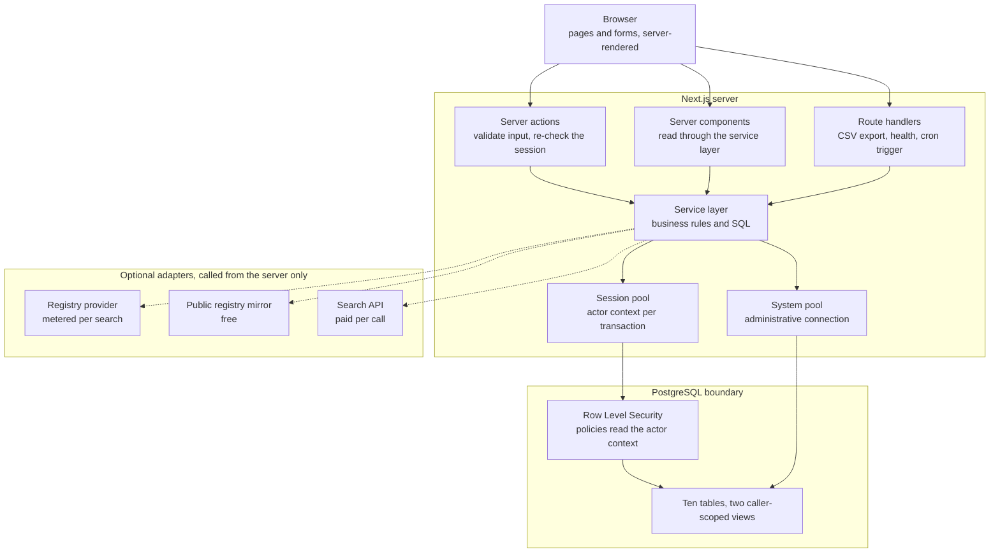

# Arquitetura

## 1. Contexto

O JER CRM é um sistema de prospecção interno, feito para uma empresa só. Três superfícies dividem o mesmo banco de dados: a fila do vendedor, os painéis de gestão e a ingestão agendada que reabastece a fila a partir de um provedor de base cadastral comercial. Não existe API pública nem nada voltado ao cliente final.

Roda como uma aplicação Next.js única, em runtime Node, com PostgreSQL. Toda credencial fica no servidor, toda chamada externa sai dele, e ele é o único cliente do banco. O navegador recebe páginas renderizadas e envia formulários.

Duas restrições moldaram o desenho. A fila de um vendedor não pode ser legível por outro, nem com requisição forjada. E o provedor de base cadastral é medido: toda busca tem custo e limite de taxa.

## 2. Componentes e responsabilidades

**Páginas.** Server components. A página resolve a sessão, chama os serviços com ela e renderiza o resultado. Não há SQL na página, e ela não decide acesso.

**Server actions.** São o único ponto de mutação que vem do navegador. Cada action valida o payload, relê a sessão, confere o papel, chama um serviço, revalida as rotas afetadas e devolve um resultado discriminado. Falha vira `{ ok: false, error, code }`, nunca stack trace.

**Route handlers.** Três exportações CSV restritas a gestores, um health check e o gatilho de cron, autenticado por um segredo compartilhado em header ou parâmetro de consulta.

**Camada de serviço.** Quinze módulos com regra de negócio e SQL. O serviço recebe a sessão explicitamente, nunca lê cookie e abre a própria transação. Também escolhe a conexão: session pool para requisição de usuário, system pool para ingestão, enriquecimento e escrituração das rodadas.

**Adapters.** Três sistemas externos atrás de módulos com o mesmo formato: timeout, parsing tolerante e um mapa de falha de transporte para a taxonomia interna de erros.

**Banco de dados.** PostgreSQL com Row Level Security em todas as tabelas. Duas views expõem desempenho diário e totais de funil, declaradas caller-scoped, então uma consulta por elas passa pelo mesmo filtro de uma consulta nas tabelas base.

## 3. Fronteiras e contratos

*Navegador para action.* Um payload tipado, validado antes do uso, e uma união de resultado: sucesso com mensagem, ou falha com mensagem e um código de um conjunto fechado.

*Página para serviço.* Um objeto de sessão mais argumentos simples. Nenhum serviço tem variante que dispense a sessão. A busca de login é a única exceção e passa por uma função de banco que devolve uma linha.

*Serviço para banco de dados.* Uma transação por unidade de trabalho. No session pool a transação começa gravando o ator e o papel nas configurações locais da transação, que as políticas leem. O system pool grava dado de referência e registro de execução, e não está sujeito às políticas, porque se conecta como dono do schema.

*Serviço para adapter.* Chamada limitada por timeout, sem retry no caminho da requisição, com resultado que traz dado ou motivo. O enriquecimento anota a fonte que falhou e segue.

## 4. Fluxo de uma requisição

Registrar um contato:

1. O vendedor clica na ação rápida. O navegador envia uma action com a atribuição, o tipo e uma nota opcional.
2. A action valida o payload, lê o cookie assinado e recusa quando falta sessão.
3. O serviço abre uma transação no session pool e define o contexto do ator.
4. Lê a atribuição. A política só devolve a linha para o dono dela ou para um gestor, então identificador forjado dá resultado vazio e erro de "não encontrado ou sem permissão".
5. Atualiza o estágio e o timestamp da última ação, e então acrescenta uma interação com tipo, estágio anterior, novo estágio, ator e hora. As duas escritas commitam juntas.
6. A action revalida a fila, o cadastro, o painel e os relatórios; a página é renderizada de novo no servidor.

Uma exportação segue o mesmo desenho com outro transporte: o route handler lê a sessão, recusa quem não for gestor, chama o serviço de relatórios e transmite um arquivo separado por ponto e vírgula. A política vale para a consulta por trás do arquivo, do mesmo jeito que vale para o painel.

## 5. Modelo de dados conceitual

**Conta.** Nome, e-mail, hash de senha, papel, meta diária, flag de ativo.

**Empresa.** Registro cadastral com chave no CNPJ: nomes, código de atividade, porte, situação, data de abertura, capital, endereço, dados de contato, perfis sociais, metadados de enriquecimento e estado de WhatsApp.

**Lote.** Uma ingestão: rótulo, filtros, fonte, contagem, autor, hora.

**Atribuição.** Uma empresa entregue a um vendedor: estágio, prioridade, timestamps, notas; única por empresa e vendedor.

**Interação.** Linha append-only por ação: ator, tipo, texto, estágio anterior e novo estágio, hora. É o registro do que aconteceu e a origem de toda métrica.

**Sócio.** Vem do registro público: qualificação, faixa etária, documento mascarado, data de entrada.

**Execução.** Uma rodada de distribuição: origem, filtros, contadores, erro, duração.

**Configuração.** Chave com valor JSON e autor; as chaves que guardam credencial são só de gestor.

**Entrada de cache e contador.** Respostas de provedor em cache com uma expiração, e uma contagem de requisições por dia.

Relações: uma empresa tem muitas atribuições e sócios; uma atribuição tem muitas interações; um lote agrupa as atribuições de uma ingestão; uma conta é dona de atribuições e interações.

## 6. Decisões de implantação

Um processo Node, em container, runtime de plataforma ou máquina virtual. PostgreSQL 14 ou mais novo é a única dependência com estado; instância gerenciada serve, porque nada exige recurso de superusuário além de criar o papel da aplicação uma vez.

Mudança de schema é arquivo SQL aplicado em ordem por um runner que anota cada nome de arquivo em uma tabela de ledger e envolve cada arquivo em transação. O runner se conecta como dono do schema; a aplicação, com papel restrito. A configuração vem de variável de ambiente, com duas chaves de provedor editáveis na interface, para que a rotação não exija deploy.

O scheduler é externo: qualquer coisa que consiga enviar requisição com segredo bearer. O health é um route handler que informa a conectividade do banco e devolve 503 quando o banco está fora.

## 7. Limites conhecidos

- O limite por minuto do provedor vive na memória do processo, então vale por instância.
- O contador diário é uma linha que toda requisição atualiza, o que serializa a escrita sob carga.
- O enriquecimento roda dentro da requisição ou da rodada agendada, sem job queue e sem retry com backoff.
- O relatório agrega na leitura e precisaria de materialização em volume muito maior.
- O system pool se conecta como dono do schema e ignora as políticas; a segurança dele depende de quais funções podem chamá-lo.
- A unicidade é por empresa e vendedor, então uma importação manual pode entregar a mesma empresa a um segundo vendedor.
- As datas são lidas como texto no driver, o que mantém a data de negócio estável e joga a formatação para a camada de apresentação.
- A exportação é só CSV, e o e-mail de saída usa o cliente do usuário por link `mailto:`, não uma API.
